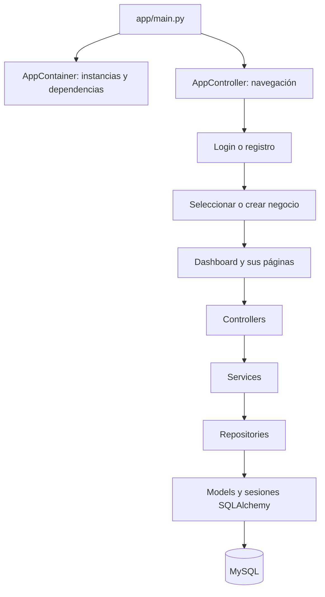
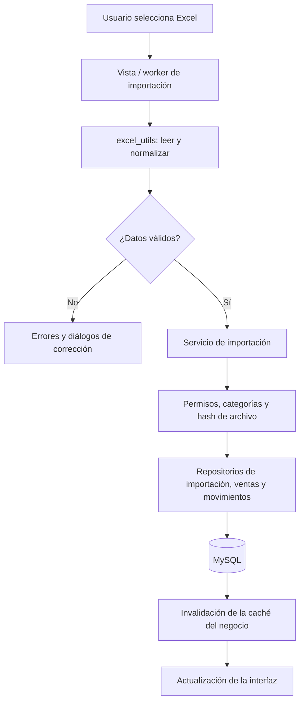
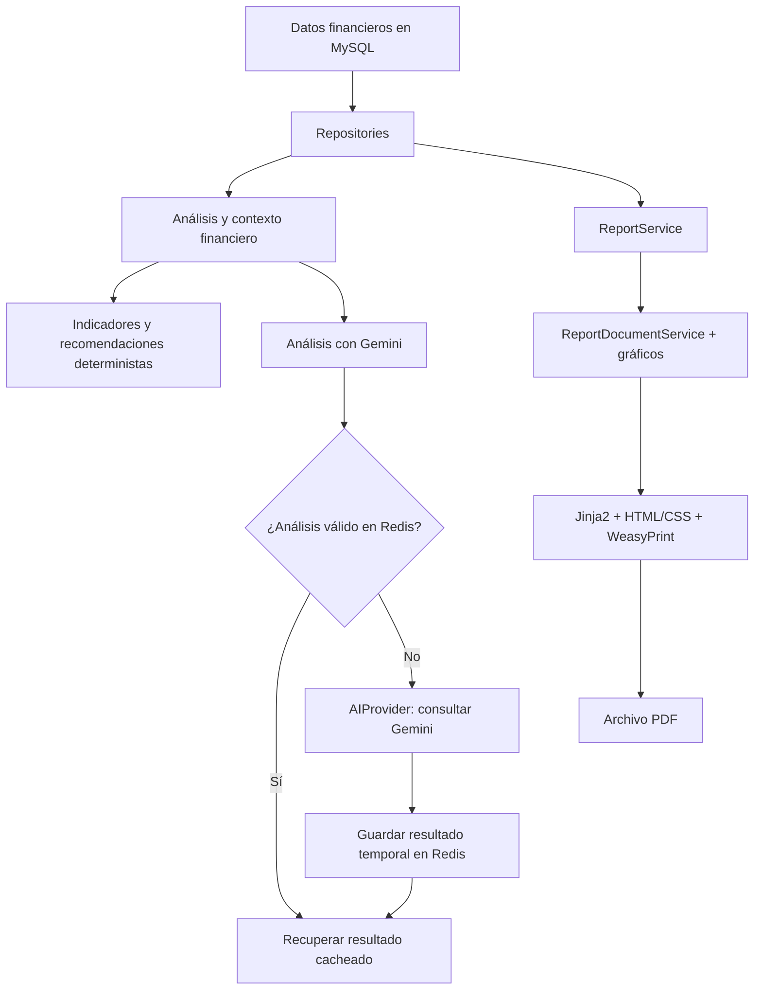

# Estructura del proyecto — Finanzen

## Introducción

Finanzen es una aplicación de escritorio para el análisis financiero de micro y pequeños negocios. Está desarrollada principalmente en **Python** y utiliza **PySide6** para la interfaz, **SQLAlchemy y MySQL** para la persistencia, **pandas y openpyxl** para los datos de Excel, **Redis** para la caché de análisis, una **API de Gemini** para determinadas funciones de IA y **Jinja2, Matplotlib y WeasyPrint** para generar reportes PDF.

**Alcance de esta documentación:** la estructura que aparece a continuación representa archivos efectivamente presentes en `main` al momento de la revisión. Para que el árbol sea legible, algunos grupos de recursos estáticos y archivos de prueba se resumen con `…`. No deben confundirse los archivos existentes con los ejemplos o propuestas de mejora.

---

## 1. Estructura general del repositorio

```text
Finanzen/
├── app/
│   ├── ai/
│   │   └── ai_provider.py
│   ├── config/
│   │   └── settings.py
│   ├── controllers/
│   │   ├── user_controller.py
│   │   ├── business_controller.py
│   │   ├── analysis_controller.py
│   │   ├── report_controller.py
│   │   ├── recommendations_controller.py
│   │   └── … (otros controladores)
│   ├── core/
│   │   ├── app_container.py
│   │   ├── app_controller.py
│   │   ├── screen_utils.py
│   │   └── security/
│   │       ├── account_validation.py
│   │       ├── authorization.py
│   │       └── password.py
│   ├── database/
│   │   ├── base.py
│   │   ├── connection.py
│   │   └── init_db.py
│   ├── errors/
│   │   └── import_errors.py
│   ├── excel_utils/
│   │   ├── excel_reader.py
│   │   ├── excel_validator.py
│   │   ├── excel_transformer.py
│   │   ├── excel_result.py
│   │   └── import_service.py
│   ├── fixtures/
│   │   ├── Finanzen_Plantilla.xlsx
│   │   ├── Club Cafe/
│   │   ├── pizza castle/
│   │   └── pruebas/
│   ├── generated/
│   │   └── resources_rc.py
│   ├── models/
│   │   ├── __init__.py
│   │   ├── users.py
│   │   ├── business.py
│   │   ├── user_business.py
│   │   ├── recovery.py
│   │   ├── category.py
│   │   ├── imports.py
│   │   ├── movement.py
│   │   └── sale.py
│   ├── pdf_templates/
│   │   ├── pdf_generator.py
│   │   ├── base_reporte.html
│   │   ├── reporte_maestro.html
│   │   ├── secciones/
│   │   └── styles/
│   ├── prompts/
│   │   └── financial_prompts.py
│   ├── repositories/
│   │   ├── user_repository.py
│   │   ├── business_repository.py
│   │   ├── sale_repository.py
│   │   ├── movement_repository.py
│   │   ├── financialContext_repository.py
│   │   └── … (otros repositorios)
│   ├── resources/
│   │   ├── fonts/
│   │   ├── icons/
│   │   ├── images/
│   │   └── resources.qrc
│   ├── services/
│   │   ├── user_services.py
│   │   ├── transaction_import_service.py
│   │   ├── analysis_service.py
│   │   ├── recommendation_service.py
│   │   ├── aiRecommendation_service.py
│   │   ├── redisCacheService.py
│   │   ├── report_service.py
│   │   ├── report_document_service.py
│   │   └── … (otros servicios)
│   ├── ui/
│   │   ├── login/
│   │   ├── dashboard/
│   │   │   ├── pages/
│   │   │   └── qdialog/
│   │   └── … (otros archivos .ui)
│   ├── utils/
│   │   ├── analysis/
│   │   ├── visualizations/
│   │   ├── recoveryCode.py
│   │   ├── validators.py
│   │   ├── date_utils.py
│   │   └── … (otras utilidades)
│   ├── views/
│   │   ├── login/
│   │   ├── createAccount/
│   │   ├── chooseABusiness/
│   │   ├── createBusiness/
│   │   ├── dashboard/
│   │   │   ├── pages/
│   │   │   ├── dialogs/
│   │   │   └── table_models/
│   │   └── profile/
│   ├── workers/
│   │   ├── ai_worker.py
│   │   ├── analysis_worker.py
│   │   ├── email_sender_worker.py
│   │   ├── excel_import_worker.py
│   │   ├── excel_save_worker.py
│   │   └── report_worker.py
│   └── main.py
├── migrations/
│   ├── env.py
│   └── versions/
│       └── … (migraciones de Alembic)
├── .env.example
├── .gitignore
├── alembic.ini
├── pyproject.toml
├── requirements.txt
├── README.md
├── estructura_proyecto.md
├── Indicaciones.md
├── Lógica de Negocio y Reglas del Sistema.md
├── consultas.sql
└── test.py
```

**Importante:** no se muestran `.env`, `venv/` ni `__pycache__/` como elementos versionados porque son archivos o directorios locales que deben permanecer fuera del control de versiones. La carpeta `generated/`, en cambio, sí contiene un archivo compilado de recursos versionado en el repositorio.

---

## 2. Carpeta `app/`: código principal

`app/` agrupa la lógica de la aplicación. La estructura ya no se limita a modelos, ventanas y utilidades: también separa **controladores, servicios, repositorios, procesamiento de Excel, tareas en segundo plano, seguridad, reportes e inteligencia artificial**.

Esta división busca evitar que las ventanas realicen directamente consultas complejas o contengan todas las reglas de negocio. Las carpetas no son completamente independientes: colaboran a través de importaciones, objetos y llamadas a métodos.

**Regla práctica:** una ventana recibe una acción del usuario; un controlador expone operaciones de la aplicación; un servicio ejecuta la lógica correspondiente; un repositorio consulta o modifica los datos mediante los modelos y la sesión de SQLAlchemy.

---

## 3. Carpeta `config/`: configuración

```text
app/config/
└── settings.py
```

`settings.py` utiliza `python-dotenv` y `os.getenv()` para cargar opciones del entorno. En el código revisado se encuentran estas variables:

| Grupo | Variables utilizadas |
|---|---|
| Correo | `EMAIL`, `PASSWORD` |
| MySQL | `DATABASE_URL` |
| Gemini | `GEMINI_API_KEY`, `GEMINI_MODEL`, `GEMINI_TEMPERATURE`, `GEMINI_MAX_OUTPUT_TOKENS`, `GEMINI_TIMEOUT` |
| Redis | `REDIS_URL` |

El archivo ofrece valores predeterminados para algunos parámetros de Gemini; no deben confundirse con credenciales. El objetivo es que otros módulos importen estas opciones desde un lugar centralizado y que **ningún secreto real quede escrito en el código ni se suba a GitHub**.

---

## 4. Carpeta `core/`: coordinación de la aplicación y seguridad

```text
app/core/
├── app_container.py
├── app_controller.py
├── screen_utils.py
└── security/
    ├── account_validation.py
    ├── authorization.py
    └── password.py
```

- **`app_container.py`**: crea y conecta las instancias de servicios y controladores. Por ejemplo, configura los servicios de importación, análisis, reportes y la instancia de Redis utilizada en diversas operaciones. También coordina el cierre de recursos mediante `close()`.
- **`app_controller.py`**: administra la navegación entre las ventanas de inicio de sesión, registro, recuperación de contraseña, selección/creación de negocio y panel principal. Conecta señales de las vistas con métodos de navegación.
- **`screen_utils.py`**: contiene utilidades relacionadas con tamaños y disposición de la interfaz.
- **`security/account_validation.py`**: reúne validaciones relacionadas con cuentas.
- **`security/authorization.py`**: contiene las comprobaciones de autorización según usuario, negocio y rol.
- **`security/password.py`**: realiza el hash y la verificación de contraseñas mediante **Argon2**.

`core/` debe contener la infraestructura transversal y la coordinación central, no convertirse en una segunda carpeta para cualquier función sin clasificar.

---

## 5. Carpeta `database/`: SQLAlchemy y conexión a MySQL

```text
app/database/
├── base.py
├── connection.py
└── init_db.py
```

- **`base.py`** define la clase `Base`, derivada de `DeclarativeBase`, de la que heredan los modelos ORM.
- **`connection.py`** crea el `engine` de SQLAlchemy a partir de `DATABASE_URL`, prepara `SessionLocal` y expone `get_session()`.
- **`init_db.py`** importa modelos relacionados con la base de datos. En la revisión actual, la instrucción `Base.metadata.create_all(...)` está comentada: **no debe describirse como un inicializador automático activo**.

Los cambios de estructura de la base de datos se gestionan mediante **Alembic**, cuya configuración se encuentra en `alembic.ini` y sus migraciones en `migrations/`.

**Distinción:** `database/` configura el acceso, `models/` describe las entidades y `repositories/` ejecuta las consultas y operaciones de persistencia.

---

## 6. Carpeta `models/`: entidades de datos

```text
app/models/
├── __init__.py
├── users.py
├── business.py
├── user_business.py
├── recovery.py
├── category.py
├── imports.py
├── movement.py
└── sale.py
```

Los archivos contienen clases SQLAlchemy que representan entidades y relaciones de la base de datos. Los nombres que aparecen a continuación reflejan los modelos del repositorio, no una propuesta hipotética.

| Archivo | Clase / responsabilidad principal |
|---|---|
| `users.py` | `Users`: cuenta, nombre, correo, hash de contraseña, fecha de nacimiento, fechas de registro y condición de administrador. |
| `business.py` | `Business`: nombre, tipo de negocio, descripción, logo, inicio de operaciones y usuario creador. |
| `user_business.py` | `UserBusiness`: vincula usuarios con negocios y asigna roles (`ADMIN`, `MANAGER`, `FINANCIAL_ANALYST`, `EMPLOYEE`). |
| `recovery.py` | `Recovery`: código, token, vencimiento y estado de uso para recuperar cuentas. |
| `category.py` | `Category`: categorías de ventas asociadas a un negocio. |
| `imports.py` | `Import`: registro del archivo importado, usuario, negocio, nombre, hash y fecha de importación. |
| `movement.py` | `Movement`: ingresos y gastos, fecha, categoría, descripción, monto, método de pago y responsables de cambios. |
| `sale.py` | `Sale`: productos/servicios vendidos, cantidades, precios, total, categoría y relación con una importación. |
| `__init__.py` | Importa las clases ORM para hacerlas conocidas desde el paquete `app.models`. |

### Relaciones esenciales

```text
Users ────────────────┐
  │                   │
  └── UserBusiness ─── Business
          │               │
          └─ rol           ├── Category
                          ├── Import ──┬── Sale
                          │            └── Movement
                          ├── Sale
                          └── Movement

Users ─── Recovery
```

El diagrama expresa asociaciones principales, no todas las claves foráneas. `Sale` se asocia a `Category`, `Business`, `Import` y usuarios responsables; `Movement` se asocia a `Business`, `Import` y usuarios responsables.

En particular, **ventas** (`sales`) y **movimientos de ingreso/gasto** (`movements`) son entidades distintas. No debe interpretarse el total de ventas como si fuera automáticamente el total de ingresos registrados o la ganancia del negocio.

---

## 7. Carpeta `repositories/`: persistencia y consultas

```text
app/repositories/
├── analysis_repository.py
├── business_repository.py
├── category_repository.py
├── configuration_repository.py
├── financialContext_repository.py
├── import_repository.py
├── monitoring_repository.py
├── movement_repository.py
├── recommendation_repository.py
├── recovery_repository.py
├── sale_repository.py
├── user_business_repository.py
└── user_repository.py
```

Los repositorios concentran el acceso a datos con SQLAlchemy y evitan repetir consultas en las ventanas.

- Los repositorios de **usuarios, negocios, categorías, recuperación y relaciones usuario-negocio** gestionan sus entidades correspondientes.
- `sale_repository.py` y `movement_repository.py` reúnen operaciones relacionadas con los registros financieros.
- `import_repository.py` está asociado a los registros de importación.
- `analysis_repository.py`, `monitoring_repository.py`, `recommendation_repository.py` y `financialContext_repository.py` reúnen consultas que alimentan cálculos, indicadores y análisis.
- `configuration_repository.py` respalda las operaciones de configuración del negocio y los datos asociados.

La capa de repositorios **no debería encargarse de dibujar interfaces o crear archivos PDF**: su responsabilidad central es obtener o persistir información.

---

## 8. Carpeta `services/`: lógica de negocio

`services/` implementa operaciones del sistema y coordina repositorios, validaciones y servicios externos.

```text
app/services/
├── aiRecommendation_service.py
├── analysis_service.py
├── business_service.py
├── category_service.py
├── configuration_service.py
├── consultation_service.py
├── home_dashboard_service.py
├── import_service.py
├── monitoring_service.py
├── recommendation_service.py
├── recovery_services.py
├── redisCacheService.py
├── remembered_accounts_service.py
├── report_analytics_service.py
├── report_document_service.py
├── report_insights_service.py
├── report_service.py
├── transaction_import_service.py
├── user_business_service.py
└── user_services.py
```

### Servicios principales

| Archivo | Función general |
|---|---|
| `user_services.py` y `recovery_services.py` | Gestión de usuarios y recuperación de cuentas. |
| `business_service.py` y `user_business_service.py` | Gestión de negocios y relaciones con usuarios. |
| `remembered_accounts_service.py` | Soporte para cuentas recordadas en el equipo. |
| `import_service.py` y `transaction_import_service.py` | Registro de importaciones y persistencia de ventas/movimientos ya procesados. |
| `category_service.py` | Obtención y gestión de categorías. |
| `home_dashboard_service.py` y `consultation_service.py` | Preparación de información consultable desde el panel y otras vistas. |
| `analysis_service.py` | Análisis financiero calculado a partir de registros y comparaciones. |
| `recommendation_service.py` | Recomendaciones basadas en reglas y cálculos definidos en el programa. |
| `aiRecommendation_service.py` | Construcción de contexto y solicitudes para análisis o preguntas mediante IA. |
| `redisCacheService.py` | Lectura, almacenamiento e invalidación de resultados temporales de IA. |
| `monitoring_service.py` y `configuration_service.py` | Operaciones de monitoreo y configuración. |
| `report_service.py`, `report_analytics_service.py`, `report_insights_service.py`, `report_document_service.py` | Obtención, análisis y preparación del documento final de reportes financieros. |

### Diferencia entre servicios y repositorios

**Repositorio:** “dame las ventas del negocio entre estas fechas”.  
**Servicio:** “calcula indicadores, comprueba permisos, compara períodos y prepara un resultado para la interfaz”.

Una operación compleja puede coordinar varios repositorios y servicios, mientras que la ventana solo necesita solicitar el resultado y mostrarlo.

---

## 9. Carpeta `controllers/`: enlace entre interfaces y operaciones

```text
app/controllers/
├── analysis_controller.py
├── business_controller.py
├── choose_business_controller.py
├── configuration_controller.py
├── consultation_controller.py
├── emails_controller.py
├── home_dashboard_controller.py
├── monitoring_controller.py
├── recommendation_controller.py
├── recommendations_controller.py
├── recovery_controller.py
├── report_controller.py
└── user_controller.py
```

Los controladores ofrecen a las vistas una forma organizada de solicitar acciones: registro de usuario, consulta de un panel, análisis, recuperación, reportes, configuración o monitoreo.

Por ejemplo, `app_container.py` instancia un `ReportController` con su servicio asociado; después `app_controller.py` entrega ese controlador a la ventana del dashboard. La aplicación también contiene **`recommendation_controller.py` y `recommendations_controller.py`**: son archivos diferentes y sus nombres deben respetarse al buscarlos.

**Buena práctica:** una clase visual no debería acoplarse directamente a todas las tablas ni resolver transacciones de base de datos por su cuenta.

---

## 10. Carpeta `excel_utils/`: lectura, validación y transformación

```text
app/excel_utils/
├── excel_reader.py
├── excel_validator.py
├── excel_transformer.py
├── excel_result.py
└── import_service.py
```

Esta carpeta procesa los archivos financieros antes de guardar su contenido:

1. **Lectura (`excel_reader.py`):** obtiene la información desde las hojas esperadas del libro Excel.
2. **Normalización (`excel_transformer.py`):** unifica encabezados y formatos de los datos.
3. **Validación (`excel_validator.py`):** detecta problemas de estructura, contenido y tipos.
4. **Resultado (`excel_result.py`):** presenta el resultado del procesamiento de forma estructurada.
5. **Orquestación (`import_service.py`):** ejecuta la secuencia anterior y devuelve datos o errores al resto de la aplicación.

El código revisado trabaja con hojas llamadas **`Ventas`** y **`Movimientos`**. Posteriormente, `app/services/transaction_import_service.py` coordina el guardado en base de datos, comprueba permisos, relaciona categorías y actualiza el estado de la caché cuando corresponde.

**No confundir** `app/excel_utils/import_service.py`, encargado de procesar el libro, con `app/services/import_service.py` y `app/services/transaction_import_service.py`, que participan en la persistencia del proceso.

---

## 11. Carpeta `errors/`: errores específicos

```text
app/errors/
└── import_errors.py
```

Contiene tipos y representaciones de errores relacionados con la importación de datos; por ejemplo, permite comunicar errores de archivos y categorías faltantes de forma más estructurada que con mensajes arbitrarios.

El objetivo es que los servicios y la interfaz puedan distinguir causas y presentarlas de forma comprensible al usuario.

---

## 12. Carpetas `ai/` y `prompts/`: integración con Gemini

```text
app/ai/
└── ai_provider.py

app/prompts/
└── financial_prompts.py
```

- **`ai/ai_provider.py`** encapsula la comunicación con la API de Gemini: crea el cliente, envía solicitudes, recibe respuestas en flujo (*streaming*) y maneja errores de proveedor, conexión, tiempo de espera, límites y cancelación.
- **`prompts/financial_prompts.py`** contiene instrucciones y plantillas para elaborar el contexto enviado al modelo. Distingue análisis **General, Ventas, Ingresos y Gastos**, además de las preguntas libres del asistente.
- **`services/aiRecommendation_service.py`** reúne datos financieros para construir el contexto. No sustituye la consulta directa a los repositorios.
- **`workers/ai_worker.py`** ejecuta las solicitudes sin bloquear la interfaz gráfica.

Las instrucciones de los prompts indican que el asistente debe basarse en los datos disponibles, responder en español, utilizar córdobas y **mantener separadas las ventas de los ingresos registrados**.

La IA añade interpretaciones en lenguaje natural. Las cifras base se obtienen de los registros financieros del sistema; una respuesta generada por IA no debe tratarse como fuente contable independiente.

---

## 13. Caché Redis: `redisCacheService.py`

El archivo `app/services/redisCacheService.py` contiene `RedisCacheService`. La configuración se obtiene de `REDIS_URL`.

En el código revisado:

- La vida útil de un análisis guardado es **86 400 segundos (24 horas)**.
- Los tipos de análisis aceptados para la caché son **General, Ventas, Ingresos y Gastos**.
- Las claves tienen en cuenta el **negocio, la versión de sus datos, la modalidad y el rango de fechas**.
- La modificación de información financiera puede invalidar los resultados anteriores aumentando la versión del negocio.
- Si Redis no está configurado o no está disponible, el servicio puede funcionar sin resultados cacheados.

**La caché no es la base de datos:** MySQL conserva los registros del negocio y Redis almacena temporalmente determinados análisis ya generados. Las preguntas libres del asistente no siguen el mismo mecanismo de caché predefinida.

---

## 14. Carpeta `pdf_templates/`: reportes financieros

```text
app/pdf_templates/
├── pdf_generator.py
├── base_reporte.html
├── reporte_maestro.html
├── secciones/
│   ├── comparativa.html
│   ├── gastos.html
│   ├── hallazgos.html
│   ├── ingresos.html
│   ├── notas.html
│   ├── portada.html
│   ├── resumen_ejecutivo.html
│   └── ventas.html
└── styles/
    └── reporte_v2.css
```

En esta parte se separa **el contenido del informe** de **su presentación visual**.

1. `report_service.py` obtiene datos del negocio y construye indicadores, períodos y comparaciones.
2. `report_analytics_service.py` y `report_insights_service.py` colaboran con los cálculos y hallazgos.
3. `report_document_service.py` prepara el documento, adapta los datos a las plantillas y genera gráficos con utilidades de Matplotlib.
4. `pdf_templates/pdf_generator.py` renderiza la plantilla con **Jinja2** y crea el PDF mediante **WeasyPrint**.
5. Las plantillas de `secciones/` definen las partes del reporte, mientras que `styles/reporte_v2.css` define los estilos.

Los tipos de reporte contemplados por el servicio incluyen **ventas, ingresos, gastos y general**. La generación del documento PDF es independiente del diseño de las ventanas de PySide6.

---

## 15. Carpetas `resources/` y `generated/`: recursos gráficos

```text
app/resources/
├── fonts/
├── icons/
│   ├── menuIcons/
│   └── nuevosIconos/
├── images/
│   └── businessIcons/
└── resources.qrc

app/generated/
└── resources_rc.py
```

`resources/` guarda recursos originales utilizados por las ventanas: imágenes, logos, iconos, tipografías y el archivo `.qrc` que describe qué recursos debe incorporar Qt.

`generated/resources_rc.py` contiene código Python **generado** a partir de `resources.qrc`, y `app/main.py` lo importa al iniciar la aplicación. No suele editarse a mano. El flujo habitual es:

```text
app/resources/resources.qrc
            │
            ▼
       pyside6-rcc
            │
            ▼
app/generated/resources_rc.py
```

Desde la raíz del repositorio, un ejemplo de compilación sería:

```bash
pyside6-rcc app/resources/resources.qrc -o app/generated/resources_rc.py
```

Este es un ejemplo del comando de Qt y **no indica que sea necesario recompilar los recursos para cada ejecución**. En el repositorio ya se encuentra el archivo generado.

---

## 16. Carpeta `ui/`: diseños de Qt Designer

```text
app/ui/
├── login/
│   ├── loginU.ui
│   └── recuperarContrasena.ui
├── dashboard/
│   ├── dashboard.ui
│   ├── home.ui
│   ├── pages/
│   │   ├── analisis.ui
│   │   ├── cargar_datos.ui
│   │   ├── cargar_excel.ui
│   │   ├── configuracion.ui
│   │   ├── informes.ui
│   │   ├── monitoreo.ui
│   │   ├── movimientos.ui
│   │   ├── recomendaciones.ui
│   │   └── … (otras páginas .ui)
│   └── qdialog/
│       ├── ExcelCategories.ui
│       └── ExcelErrors.ui
├── createAccount.ui
├── creatingBusiness.ui
├── chooseAnAccount.ui
├── chooseAnBusiness.ui
├── chooseBusiness.ui
└── perfil.ui
```

Los archivos `.ui` representan el diseño visual de las ventanas y los componentes producidos con **Qt Designer**.

Aquí se definen elementos como botones, etiquetas, formularios, tablas y contenedores. La interacción y el tratamiento de los datos se programan en Python dentro de `views/`.

**Ejemplo real:** el dashboard carga `app/ui/dashboard/home.ui` usando `QUiLoader`, y después busca los componentes necesarios para conectar sus eventos.

---

## 17. Carpeta `views/`: ventanas y páginas de la aplicación

```text
app/views/
├── login/
│   ├── login.py
│   └── recuperarContra.py
├── createAccount/
│   └── createAccount.py
├── chooseABusiness/
│   ├── chooseABusiness.py
│   └── tarjetaNegocio.py
├── createBusiness/
│   └── createBusiness.py
├── dashboard/
│   ├── dashboard.py
│   ├── dialogs/
│   │   ├── excel_categories.py
│   │   └── excel_errors.py
│   ├── pages/
│   │   ├── dashboard_home.py
│   │   ├── cargar_datos.py
│   │   ├── analisis.py
│   │   ├── movimientos.py
│   │   ├── recommendations.py
│   │   ├── recomendaciones.py
│   │   ├── informes.py
│   │   ├── configuracion.py
│   │   ├── monitoreo.py
│   │   └── emails.py
│   └── table_models/
│       ├── imports_model.py
│       ├── movements_model.py
│       ├── movements_table_model.py
│       ├── sales_model.py
│       ├── sales_table_model.py
│       └── table_widgets.py
├── profile/
│   └── profile.py
└── estilosTipografia.py
```

Las **vistas** son las clases Python encargadas de las ventanas, páginas, diálogos y modelos que utiliza la interfaz.

### Pantallas de acceso

- `login/login.py`: inicio de sesión.
- `login/recuperarContra.py`: recuperación de contraseña.
- `createAccount/createAccount.py`: creación de cuentas.
- `chooseABusiness/`: elección del negocio y presentación de tarjetas de negocios.
- `createBusiness/createBusiness.py`: creación de un negocio.

### Dashboard

- `dashboard/dashboard.py`: ventana principal, navegación, manejo de páginas y restricciones visuales de acceso según rol.
- `dashboard/pages/`: páginas de inicio, carga de datos, análisis, movimientos, recomendaciones, informes, configuración, monitoreo y correo.
- `dashboard/dialogs/`: ventanas de diálogo utilizadas en el proceso de importación de Excel.
- `dashboard/table_models/`: modelos para presentar información de ventas, movimientos e importaciones en tablas Qt.
- `profile/profile.py`: interfaz del perfil.
- `estilosTipografia.py`: apoyo a los estilos tipográficos de las ventanas.

**Distinción clave:** `ui/` define la estructura visual, mientras `views/` conecta esa estructura con eventos, controladores y datos. No todas las páginas tienen por qué contener la lógica del negocio: parte de esta se delega en los servicios.

---

## 18. Carpeta `workers/`: tareas en segundo plano

```text
app/workers/
├── ai_worker.py
├── analysis_worker.py
├── email_sender_worker.py
├── excel_import_worker.py
├── excel_save_worker.py
└── report_worker.py
```

Los *workers* sirven para realizar tareas que pueden durar más tiempo sin inmovilizar la interfaz Qt.

- **`ai_worker.py`**: solicitudes de análisis y preguntas al proveedor de IA; contempla cancelación y emisión de resultados/errores mediante señales Qt.
- **`analysis_worker.py`**: procesamiento de análisis fuera del hilo principal de la interfaz.
- **`email_sender_worker.py`**: envío de mensajes.
- **`excel_import_worker.py`**: lectura/procesamiento de archivos Excel.
- **`excel_save_worker.py`**: guardado de los datos importados.
- **`report_worker.py`**: preparación o generación de reportes en segundo plano.

El patrón habitual de una tarea es: **la vista inicia el worker → el worker ejecuta su trabajo → emite una señal → la vista actualiza la interfaz**. Esto reduce la necesidad de bloquear la ventana mientras se procesan archivos, se construyen informes o se consulta una API externa.

---

## 19. Carpeta `utils/`: funciones auxiliares reutilizables

```text
app/utils/
├── analysis/
│   ├── comparison_functions.py
│   ├── finding_functions.py
│   └── statistical_functions.py
├── visualizations/
│   └── analysis_charts.py
├── category_utils.py
├── date_utils.py
├── format_utils.py
├── hash_utils.py
├── recommendation_functions.py
├── recommendation_presenter.py
├── recoveryCode.py
├── report_charts.py
├── utilsUI.py
└── validators.py
```

Esta carpeta concentra cálculos y utilidades que se reutilizan en distintas áreas:

- `analysis/`: comparaciones, hallazgos y funciones estadísticas para análisis deterministas.
- `visualizations/analysis_charts.py` y `report_charts.py`: apoyo a las visualizaciones y gráficas.
- `date_utils.py` y `format_utils.py`: tratamiento de fechas y formato de valores.
- `category_utils.py` y `hash_utils.py`: herramientas relacionadas con categorías y hashes.
- `recommendation_functions.py` y `recommendation_presenter.py`: apoyo al cálculo y presentación de recomendaciones.
- `utilsUI.py` y `validators.py`: utilidades para la interfaz y validaciones.
- `recoveryCode.py`: generación de códigos/tokens de recuperación y funciones asociadas al envío de correo; el código incluye una clase basada en `QThread`.

**Criterio de organización:** colocar aquí una función cuando sea genérica y reutilizable. Una operación completa del negocio que consulta repositorios y aplica permisos suele encajar mejor en `services/`.

---

## 20. Carpeta `fixtures/`: archivos de ejemplo y pruebas de importación

```text
app/fixtures/
├── Finanzen_Plantilla.xlsx
├── Club Cafe/
│   └── … (libros Excel y archivos CSV)
├── pizza castle/
│   └── … (libro Excel y archivos CSV)
└── pruebas/
    └── … (archivos Excel de prueba)
```

Aquí se guardan **datos de ejemplo y materiales que ayudan a probar el proceso de importación**. Incluye una plantilla de Excel y conjuntos de datos para negocios de ejemplo.

Estos archivos no son entidades SQLAlchemy ni recursos gráficos de la interfaz. Conviene mantenerlos diferenciados de la información privada de negocios reales y no publicar datos sensibles al elaborar nuevos casos de prueba.

---

## 21. Carpeta `migrations/` y archivo `alembic.ini`

```text
migrations/
├── env.py
└── versions/
    ├── c5b2ee0985ba_initial_migration.py
    ├── 9a1d1c50ccec_add_admin_role_and_is_admin_flag.py
    ├── 9feb4ab5e75e_add_referential_integrity_rules.py
    └── 3a8916465ae0_add_performance_indexes.py

alembic.ini
```

**Alembic** permite llevar un historial de cambios en el esquema de la base de datos: creación de tablas, roles, reglas de integridad e índices.

- `alembic.ini`: configuración de Alembic.
- `migrations/env.py`: conecta Alembic con `Base.metadata` y la URL de base de datos configurada.
- `migrations/versions/`: revisiones que documentan la evolución del esquema.

Si cambia una clase ORM de `models/`, es importante revisar si el cambio necesita una migración. **Modificar un modelo no actualiza automáticamente las tablas existentes.** La ejecución de migraciones requiere una base de datos configurada y medidas de respaldo adecuadas.

---

## 22. Archivo `main.py`: punto de entrada

```text
app/
└── main.py
```

`app/main.py` es el punto de entrada de Finanzen. El archivo actual:

1. Crea una instancia de `QApplication`.
2. Configura el nombre **Finanzen** y su icono de aplicación.
3. Importa los recursos Qt generados y los modelos.
4. Construye `AppContainer` con los servicios y controladores.
5. Construye `AppController` y llama a `start()`, que muestra el login.
6. Conecta la salida de la aplicación con la liberación de recursos del contenedor.
7. Ejecuta el ciclo de eventos de Qt.

La ejecución indicada en el README es:

```bash
python -m app.main
```

Debe ejecutarse desde la raíz del proyecto, una vez configurado el entorno y los servicios que utiliza.

---

## 23. Archivos principales en la raíz

| Archivo | Responsabilidad |
|---|---|
| `README.md` | Presentación del sistema, funcionalidades, requisitos y ejecución. |
| `pyproject.toml` | Metadatos del proyecto y declaración de un conjunto de dependencias; indica `requires-python = ">=3.14"`. |
| `requirements.txt` | Lista de dependencias de Python con versiones fijadas. |
| `.env.example` | Ejemplo de variables de entorno sin secretos reales. |
| `.gitignore` | Archivos que Git debe ignorar: entre otros, `venv/`, `__pycache__/`, `.env` y archivos locales de bases de datos. |
| `alembic.ini` | Configuración de migraciones. |
| `estructura_proyecto.md` | Documento histórico sobre la estructura del proyecto; era la base de la versión inicial de esta guía. |
| `Indicaciones.md` | Indicaciones complementarias incluidas en el repositorio. |
| `Lógica de Negocio y Reglas del Sistema.md` | Documento de reglas de negocio. |
| `consultas.sql` | Consultas SQL incluidas como material del proyecto. |
| `test.py` | Archivo Python de pruebas o experimentación; su presencia no demuestra por sí sola una suite automatizada completa. |

### `.env` y `.env.example`

La configuración real se guarda normalmente en un archivo local `.env`, que **no debe versionarse**. En la versión del repositorio revisada, `.env.example` solo enumera `EMAIL`, `PASSWORD` y `DATABASE_URL`, aunque `settings.py` también lee `GEMINI_API_KEY`, otras opciones de Gemini y `REDIS_URL`.

**Mejora recomendada:** completar `.env.example` con todas las claves que usa `settings.py`, manteniendo sus valores vacíos o seguros y sin incluir credenciales reales. Esta recomendación describe una diferencia observada; no significa que esos cambios ya se hayan realizado en el repositorio.

### Entorno virtual (`venv/`) y cachés de Python

`venv/` contiene las dependencias instaladas para un entorno local de desarrollo. `__pycache__/` guarda archivos compilados `.pyc` creados automáticamente por Python. Ambos deben mantenerse fuera del control de versiones; no forman parte del árbol versionado mostrado en la sección 1.

---

## 24. Flujo de funcionamiento de la aplicación

### 24.1. Inicio y navegación



Este esquema es **conceptual**: una vista puede necesitar servicios y utilidades de forma indirecta, y no todas las llamadas pasan obligatoriamente por el mismo controlador.

### 24.2. Importación de datos financieros



### 24.3. Análisis con IA y reportes



En la rama de Gemini, el cacheo corresponde a las modalidades predefinidas. Las consultas libres siguen un flujo de solicitud diferente y no se guardan automáticamente en esa caché.

---

## 25. Resumen de responsabilidades y criterios de mantenimiento

| Componente | Pregunta que responde |
|---|---|
| `config/` | ¿Con qué configuración se ejecuta el sistema? |
| `core/` | ¿Cómo se inicia, coordina, navega y protege la aplicación? |
| `database/` | ¿Cómo se crea la conexión y la sesión ORM? |
| `models/` | ¿Cómo se representan las entidades y relaciones persistidas? |
| `repositories/` | ¿Cómo se consultan o modifican los datos? |
| `services/` | ¿Qué reglas y operaciones ejecuta el negocio? |
| `controllers/` | ¿Cómo expone la aplicación sus operaciones a las vistas? |
| `excel_utils/` | ¿Cómo se leen, validan y transforman archivos Excel? |
| `errors/` | ¿Cómo se describen errores específicos? |
| `ai/` y `prompts/` | ¿Cómo se construyen y envían las solicitudes al modelo de IA? |
| `pdf_templates/` | ¿Cómo se estructura y genera un reporte PDF? |
| `ui/` | ¿Cómo está diseñado visualmente cada formulario? |
| `views/` | ¿Cómo se presentan los datos y gestionan interacciones? |
| `workers/` | ¿Qué procesos se realizan fuera del hilo principal de la interfaz? |
| `utils/` | ¿Qué cálculos y funciones genéricas se reutilizan? |
| `resources/` y `generated/` | ¿Dónde están los recursos originales y compilados de Qt? |
| `fixtures/` | ¿Qué ejemplos permiten verificar el procesamiento de datos? |
| `migrations/` | ¿Cómo evoluciona el esquema de la base de datos? |
| `main.py` | ¿Dónde arranca el programa? |

### Pautas para agregar funcionalidades

1. **Nueva pantalla:** diseñar un `.ui` en `app/ui/` e implementar la lógica visual correspondiente en `app/views/`.
2. **Nueva operación del sistema:** ubicar su coordinación en un servicio y, si corresponde, exponerla mediante un controlador.
3. **Nueva consulta o persistencia:** incorporarla al repositorio adecuado; modificar modelos y migraciones si cambia el esquema.
4. **Nuevo cálculo reutilizable:** considerar una función en `utils/` si no representa una operación de negocio completa.
5. **Tarea que puede bloquear la interfaz:** evaluar su ejecución con un worker y comunicación mediante señales de Qt.
6. **Nuevo análisis con IA:** reutilizar el contexto financiero, los prompts y el proveedor sin colocar credenciales ni solicitudes HTTP dentro de una vista.
7. **Nuevo reporte:** mantener los datos y cálculos en `services/`, las gráficas en sus utilidades y la presentación en `pdf_templates/`.